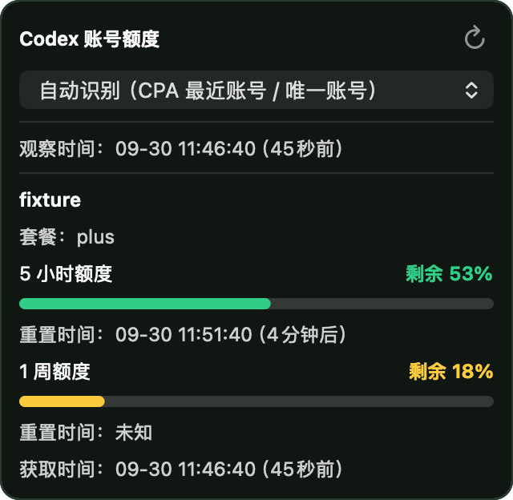

# Codex Quota Menubar for CPA

A native macOS menu bar widget for [EasyCLIProxyAPI (CPA)](https://github.com/router-for-me/EasyCLIProxyAPI). It shows **remaining Codex five-hour and weekly quotas**, account selection, and reset times. The native application is embedded in the plugin, so users need no Python, Node, Xcode, administrator password, or separate helper download.




The preview uses sample data and contains no real account.

## Install from CPA

1. Use a current CPA release with a plugin-capable CLIProxyAPI core, and start the core.
2. Add or authorize a valid **Codex OAuth** account in CPA.
3. Enable CPA's global plugin switch.
4. Add the project registry URL below under **Plugins → Settings → Additional store sources**.
5. Find **Codex Quota Menubar** in the plugin store, complete CPA's source confirmation, and click Install. The menu bar capsule starts automatically when the plugin is enabled.

This macOS-only plugin is distributed through the project's third-party CPA store source. Official-store publication is no longer planned. Use this source for installation and updates:

```text
https://raw.githubusercontent.com/RoyalXC/cpa-plugin-codex-quota-menubar/main/registry.json
```

This additional source pins published HTTPS package URLs, SHA-256 checksums, and sizes. It does not need GitHub release API requests. Future releases update the same source automatically after both architecture packages have passed verification.

The supported platform is macOS. Each release provides separate `darwin_arm64` and `darwin_amd64` packages; CPA selects the package matching the **core process architecture**, including Intel CPA running through Rosetta on Apple Silicon.

Builds target macOS 13+. Runtime validation results are documented below; a deployment target alone does not establish compatibility with every older macOS release. Initial builds are ad-hoc signed and **not Apple-notarized**. Build metadata records the exact signing status. Developer ID signing and notarization are supported by the build script when the maintainer provides the corresponding credentials.

Shareable Chinese installation guide: [安装流程与菜单栏使用](docs/INSTALL.zh-CN.md).

## Use the menu bar

- The capsule shows **remaining**, rather than consumed, quota. Five-hour quota takes precedence; if absent, it uses an available returned period.
- Click to view the account, all returned quota windows, reset times, and the time the data was fetched.
- Select an account or use automatic identification based on CPA's latest eligible Codex OAuth request. This selection affects quota display only; it does not change CPA routing.
- Click the refresh icon to query again. CPA usage events also trigger debounced refreshes. Requests that bypass CPA do not create these events.
- `--%` means the account or quota is unknown; `*` indicates an expired cached result.
- Right-click (or Control-click) the capsule and choose **Quit**. Disable and re-enable the plugin to resume it.

The widget does not represent third-party API-key model quotas. After third-party requests, it may retain the last eligible Codex OAuth account's quota and labels that source. Account credentials must be renewed in CPA when expired; the widget does not refresh OAuth tokens.

## Configuration and data

Defaults work with the standard CPA macOS installation. The plugin configuration supports:

| Field | Default / purpose |
| --- | --- |
| `cpaHome` | `~/Library/Application Support/com.cpa.gui`; CPA data directory |
| `authDir` | Optional explicit OAuth directory; otherwise determined from CPA configuration |
| `managementPort` | `8317`; local CPA lifecycle checks |
| `dataDir` | `~/Library/Application Support/CodexQuotaMenubar`; private widget settings, state, and deployed versions |
| `allowUnauthenticatedRequests` | `false`; when `true`, accept all proxy API requests without checking credentials, including requests with no token or an invalid token. Intended for a local-only CPA instance. |

Starting with 0.6.0, the plugin can also provide optional proxy API authentication bypass. In CPA's plugin configuration, set `allowUnauthenticatedRequests` to `true` to enable it, or `false` to restore normal CPA authentication. The field is a boolean and defaults to `false` when omitted. For YAML configuration, merge this field into the existing plugin entry:

```yaml
plugins:
  enabled: true
  configs:
    codex-quota-menubar:
      enabled: true
      allowUnauthenticatedRequests: true
```

This accepts requests from Codex's built-in `openai` provider using its existing OAuth token, without reading or validating the token. It applies to all proxy models and clients, not just Codex. Management API authentication remains separate. Use a CPA listener bound to `127.0.0.1` for this local-only mode. The option does not change upstream credentials, account routing, or quota selection. Changing only this option does not restart the menu bar helper; disabling the plugin removes its bypass, and quitting only the menu bar does not turn bypass off.

Paths are resolved on the user's Mac, not embedded from the build machine. The helper is deployed under a version and payload hash directory. Settings are separate, so reinstalling a version does not erase account selection. A bounded local socket handshake verifies the helper version and readiness before the plugin reports a successful registration.

The widget reads local account files and usage records, and queries the fixed official ChatGPT usage endpoint. Credentials are not copied into its data directory, logged, or sent to third-party endpoints. Settings and diagnostic state contain no OAuth token. The capsule does not require Accessibility or screen recording permission.

Disabling or uninstalling the plugin, closing the core, or a core crash stops a helper owned by that plugin. A compatible independently launched instance remains independent. Re-enabling resumes the widget. Uninstalling the plugin retains private settings and deployed versions; closing a core or hot-upgrading does not delete user data. Remove the widget data directory only after all instances have stopped if complete cleanup is desired.

## Build and verify

Build-time dependencies are macOS, Python 3.11+, and Apple command-line development tools. The macOS 27 status-item enhancement is conditionally compiled when that SDK is available; older SDKs use the existing status-button implementation.

```bash
python3 -m unittest discover -s tests -p 'test_*.py' -v
python3 scripts/build_release.py --arch arm64
python3 scripts/build_release.py --arch amd64
python3 scripts/verify_release.py dist
"build/arm64/Codex Quota Menubar.app/Contents/MacOS/QuotaMenubar" --self-test
```

To exercise the **real CPA store downloader, checksum verification, installation, registration, menu bar readiness, disable/re-enable, and core-exit lifecycle** in isolated temporary directories:

```bash
python3 scripts/cpa_smoke.py \
  --core /path/to/cli-proxy-api \
  --artifact dist/codex-quota-menubar_0.6.0_darwin_arm64.zip
```

This test creates its own core configuration and authentication directory and does not modify an existing CPA installation. It verifies default API key enforcement, anonymous and invalid-token bypass, runtime toggling, management API protection, and plugin disable/re-enable. Passing `--cpa-home /path/to/CPA-data` optionally permits the helper to read an existing account directory for a real quota check; credentials are never copied or modified.

For a signed and notarized payload:

```bash
python3 scripts/build_release.py --arch arm64 \
  --identity "Developer ID Application: YOUR NAME (TEAMID)" \
  --notary-profile YOUR_KEYCHAIN_PROFILE
```

The helper is signed and optionally notarized/stapled **before** embedding; it is not modified after deployment. The outer plugin is then signed. Verify the resulting build in the actual CPA release used for distribution.

## Validation

For 0.6.0, local validation on macOS 27 passed 33 Python tests and 229 native helper self-test checks for each architecture (Intel under Rosetta). Both packages passed isolated CLIProxyAPI 8.0.27 store installation, default API key enforcement, bypass toggling, management API protection, plugin disable/re-enable, and helper lifecycle checks. The arm64 package also passed the same checks with CLIProxyAPI 8.0.37. These checks used empty fixture account directories and did not exercise real upstream model requests or real-account quota retrieval.

On October 13, 2026, the [v0.5.0 release CI](https://github.com/RoyalXC/cpa-plugin-codex-quota-menubar/actions/runs/38375323674) passed on native macOS 15 Apple Silicon and Intel runners using SDK 15.5: 25 Python tests, 227 native helper self-test checks per architecture, package validation, and real CLIProxyAPI 8.0.27 store/lifecycle checks with an isolated fixture registry. The [source-publication CI](https://github.com/RoyalXC/cpa-plugin-codex-quota-menubar/actions/runs/38377559307) repeated both architecture builds with 30 Python tests, including source-update and downgrade-protection checks.

On macOS 27.0.1 (Apple Silicon), both actual published packages passed installation through the public HTTPS additional source using CLIProxyAPI 8.0.27: download/checksum verification, registration, status-item readiness, disable/re-enable, and helper exit on core shutdown for arm64 and amd64/Rosetta. An arm64 check read existing CPA accounts without copying or changing credentials and confirmed real quota availability.

The existing CPA 0.3.34 installation was then upgraded from local plugin 0.4.0 through that public source. Version 0.5.0 registered and launched an owned `cpa-managed` helper; its first real quota request succeeded with `quotaAvailable=true`, `loading=false`, and `stale=false`. The old independent widget stopped. Status-item readiness was verified from native application state; the computer-use interface could not inspect the menu bar app, so these checks do not claim a GUI Install-button click or a captured real-account popover. Older systems beyond these validation environments still require testing.

## Release and third-party store source

`VERSION` must match a `v<version>` tag. GitHub Actions builds and tests native Apple Silicon and Intel packages, generates `checksums.txt`, and publishes the tagged release. Store archives contain only `codex-quota-menubar.dylib` at their root, with the complete native application carried inside that library.

The project's `registry.json` is the third-party CPA store source for this macOS-only plugin. Its direct-install entries pin published package URLs, checksums, and sizes, and preserve published version history; old tag reruns cannot downgrade its current version. `store-entry.json` supplies shared plugin metadata to the source generator. Future tagged releases automatically update this same source after both macOS architecture packages pass verification. Users can keep the source configured in CPA to install and update the plugin.

The official-store submission has been closed, and official-store publication is no longer planned. Distribution continues through this repository's third-party source.

## 中文安装说明

本组件仅支持 macOS，通过本项目的第三方 CPA 商店来源分发，不提交 CPA 官方插件商店。在 CPA 中授权 Codex OAuth 账号，启动支持插件的内核并开启插件总开关，再在“插件 → 设置 → 附加商店来源”加入上面的 `registry.json` 地址。在插件商店找到 **Codex Quota Menubar**，完成 CPA 自带的来源确认后安装；启用插件后菜单栏自动出现额度胶囊。用户无需安装 Python 或 Xcode。

安装和后续更新均使用同一个附加来源。菜单栏数字表示剩余额度，点击可查看 5 小时、周额度及重置时间；下拉框只选择展示账号，刷新图标手动更新，右键“退出”可停止组件。重新禁用/启用插件可恢复。

## License

MIT. Extracted from the author's original local model-adapter project; this repository contains only the native quota plugin and menu bar application.
